# Bilbaobizi 2021: Exploratory Analysis of Urban Mobility

> Exploratory Data Analysis (EDA) project on Bilbao's public bike-sharing system through the integration of mobility and weather data.

---

## Table of Contents

- [Project Description](#project-description)
- [Objectives](#objectives)
- [Data Sources](#data-sources)
- [Technologies Used](#technologies-used)
- [Project Structure](#project-structure)
- [Project Pipeline](#project-pipeline)
- [Data Cleaning and Validation](#data-cleaning-and-validation)
- [Data Integration](#data-integration)
- [Analysis Performed](#analysis-performed)
- [Project Scripts](#project-scripts)
- [Results](#results)
- [Key Findings](#key-findings)
- [Technical Challenges](#technical-challenges)
- [Conclusions](#conclusions)
- [Future Improvements](#future-improvements)
- [Installation and Usage](#installation-and-usage)
- [License](#license)

---

## Project Description

This project analyses the usage patterns of **Bilbaobizi**, Bilbao's public bike-sharing system, during **2021**, integrating mobility records with weather data obtained through the **AEMET OpenData API**.

The objective is to analyse how **temporal**, **weather-related** and **spatial** factors relate to service demand.

The project follows an **end-to-end workflow**, from data collection and cleaning to the creation of visualisations and interactive maps.

> **Important**
>
> This project does **not aim to predict demand using Machine Learning models**.
>
> Its purpose is to understand how the system operates through **Exploratory Data Analysis (EDA)** techniques.

---

## Objectives

This project aims to answer questions such as:

- When is Bilbaobizi used the most?
- What relationship exists between weather conditions and demand?
- Which stations have the highest activity levels?
- Are there clearly identifiable origin or destination stations?
- Which routes account for the highest number of journeys?
- How is system usage distributed geographically across Bilbao?

The purpose of the project is to obtain useful insights into the system's usage patterns through exploratory data analysis techniques.

---

## Data Sources

The project combines two independent data sources: Bilbaobizi mobility records and weather data from AEMET.

### Mobility Data

Historical Bilbaobizi data was obtained through a request submitted to the Transparency Department of Bilbao City Council.

The dataset contains information about journeys made within the system, including:

- Origin station.
- Destination station.
- Journey start date and time.
- Journey end date and time.
- Journey duration.

Obtaining this data was one of the initial stages of the project and provided the records needed to analyse mobility patterns during 2021.

The available mobility records cover the period from January 1 to December 27, 2021. Therefore, mobility data does not cover the final four days of the year, although the weather data does cover the entire year.

### Weather Data

Weather data was obtained through the **AEMET OpenData API**.

An automated download process was developed to retrieve the information for 2021, taking into account the API's limitations and the possibility of incomplete responses or temporary errors.

The process included:

- Automatic retries in case of connection and download errors;
- Checks of HTTP responses;
- Identification of months whose downloads had not been completed successfully;
- Delays between certain requests to avoid exceeding API limits;
- Final validation of the data's time coverage.

Once the download was completed, the weather data was validated to ensure coverage of all 365 days of 2021, from January 1 to December 31, with no missing or duplicate dates.

### Dataset Summary

| Feature | Value |
|----------------|------:|
| Analysis period | 2021 |
| Original journeys | 721,777 |
| Analysed journeys | 681,489 |
| Stations | 43 |
| Weather source | AEMET OpenData API |

### Why 2021?

The analysis focuses on 2021 because it was the only year among the mobility data provided by the City Council with sufficiently complete and consistent coverage to carry out a reliable analysis.

In addition, complete weather data was available for the same period, allowing both sources to be integrated while maintaining temporal consistency throughout the year.

---

## Technologies Used

- Python
- Pandas
- Matplotlib
- python-dotenv
- Folium
- CARTO
- Requests
- AEMET OpenData API
- Git / GitHub

---

## Project Structure

The project is organised into folders to separate the original data, processed data, analysis scripts and generated visualisations.

```text
bilbao-urban-mobility-analysis/
│
├── data/
│   ├── processed/                    # Cleaned and integrated data
│   └── raw/                          # Original data and downloads
│
├── outputs/
│   ├── analisis_estaciones/          # Station analysis results
│   ├── estaciones/                   # Station charts and maps
│   ├── factores_demanda/             # Weather-related analysis
│   └── patrones_movilidad/           # Journey pattern analysis
│
├── scripts/
│   ├── 01-clima.py                   # Weather data download
│   ├── 02-limpieza_movilidad.py      # Mobility data cleaning
│   ├── 03-merge.py                   # Mobility and weather data integration
│   ├── 04-depuracion_final.py        # Final data validation and cleaning
│   ├── 05-eda.py                     # Exploratory data analysis
│   ├── 06-patrones_movilidad.py      # Temporal pattern analysis
│   ├── 07-analisis_estaciones.py     # Station activity analysis
│   ├── 08-factores_demanda.py        # Relationship between weather and demand
│   ├── 09-ranking_estaciones.py      # Station ranking
│   ├── 10-mapa_estaciones.py         # Station activity map
│   ├── 11-heatmap_estaciones.py      # Activity heatmap
│   └── 12-mapa_OD.py                 # Origin-Destination flow map
│
├── .env.example
├── .gitignore
├── LICENSE
├── README_EN.md
├── README_ES.md
└── requirements.txt
```

### Environment Variables

The project uses a `.env` file to store the required API keys:

- `AEMET_API_KEY`: used to retrieve weather data from AEMET.
- `CARTO_API_KEY`: used to generate interactive maps with Folium and CARTO.

The `.env` file is excluded from the repository through `.gitignore` to prevent credentials from being published. An `.env.example` file is included as a configuration template.

---

## Project Pipeline

```text
Data Collection
        │
        ▼
Data Cleaning and Validation
        │
        ▼
Dataset Integration
        │
        ▼
EDA
        │
        ▼
Temporal Analysis
        │
        ▼
Weather Analysis
        │
        ▼
Station Analysis
        │
        ▼
Spatial Analysis
        │
        ▼
Visualisations
        │
        ▼
Findings and Conclusions
```

---

## Data Cleaning and Validation

Before starting the analysis, both datasets had to be prepared.

The main transformations included:

- Removing journeys shorter than 2 minutes.
- Removing journeys longer than 180 minutes.
- Converting numerical variables from Spanish number formats.
- Standardising date formats.
- Creating derived temporal variables such as `hour`, `day of the week` and normalised `date`.
- Reviewing and handling missing values.
- Validating time coverage.
- Checking the quality of the data integration process.

Of the 721,777 records corresponding to 2021, 39,448 journeys were excluded because their duration did not meet the established criteria (between 2 and 180 minutes), leaving 682,329 records. After integrating the datasets, a further cleaning step removed 840 journeys associated with internal-service stations, such as workshops and testing stations. The final dataset used for the analysis contained 681,489 journeys.

---

## Data Integration

Once both datasets had been cleaned, they were integrated using the date as a common key.

Several checks were then performed on the resulting dataset:

- Correspondence between mobility dates and the available weather records.
- Validation of the relationship between both datasets to prevent row multiplication during the join.
- Checks for missing values in essential weather variables.
- Checks on the structure and consistency of the resulting dataset.

The result is a single dataset prepared for the different stages of analysis.

---

## Analysis Performed

The analysis is structured into four main areas:

### Temporal Patterns

Journey distribution is analysed according to:

- Time of day.
- Day of the week.
- Month.
- Changes over time throughout 2021.

---

### Weather Factors

The relationship between demand and different weather variables is studied, as well as differences according to the type of day:

- Precipitation.
- Sunshine hours.
- Maximum temperature.
- Day type.

**Note on Daily Demand Calculations**

The analysis of factors influencing demand uses days with valid journey records, applying the data cleaning criteria established in the project (journey duration between 2 and 180 minutes).

Days without valid journeys are excluded from the calculation of averages, as journey records alone cannot determine whether these days correspond to periods with no service activity or periods with unavailable data.

Therefore, the results represent average demand on days with recorded activity, rather than average demand across all calendar days of the year.

---

### Station Analysis

Activity indicators are calculated for each station:

- Departures.
- Arrivals.
- Total activity.
- Balance between arrivals and departures.

Total activity is calculated by adding the departures and arrivals recorded at each station. This makes it possible to identify stations with higher movement volumes and distinguish those that predominantly generate or receive journeys.

---

### Spatial Analysis

The system's activity is represented geographically through:

- Station activity map.
- HeatMap.
- Origin-Destination flow map.

---

## Project Scripts

| Script | Description |
|---------|-------------|
| 01-clima.py | Downloads weather data from the AEMET API. |
| 02-limpieza_movilidad.py | Cleans and prepares mobility data. |
| 03-merge.py | Integrates mobility and weather data. |
| 04-depuracion_final.py | Validates and cleans the final dataset. |
| 05-eda.py | Initial exploration of the dataset. |
| 06-patrones_movilidad.py | Temporal demand analysis. |
| 07-analisis_estaciones.py | Calculation and analysis of general station indicators. |
| 08-factores_demanda.py | Analysis of the relationship between weather and demand. |
| 09-ranking_estaciones.py | Station ranking and chart generation. |
| 10-mapa_estaciones.py | Interactive station activity map. |
| 11-heatmap_estaciones.py | System activity heatmap. |
| 12-mapa_OD.py | Interactive Origin-Destination flow map. |

---

## Results

### 1. Temporal Mobility Patterns

The temporal analysis identifies variations in demand according to the time of day, day of the week and month, showing the main usage patterns of the service.

#### Journey Distribution by Hour

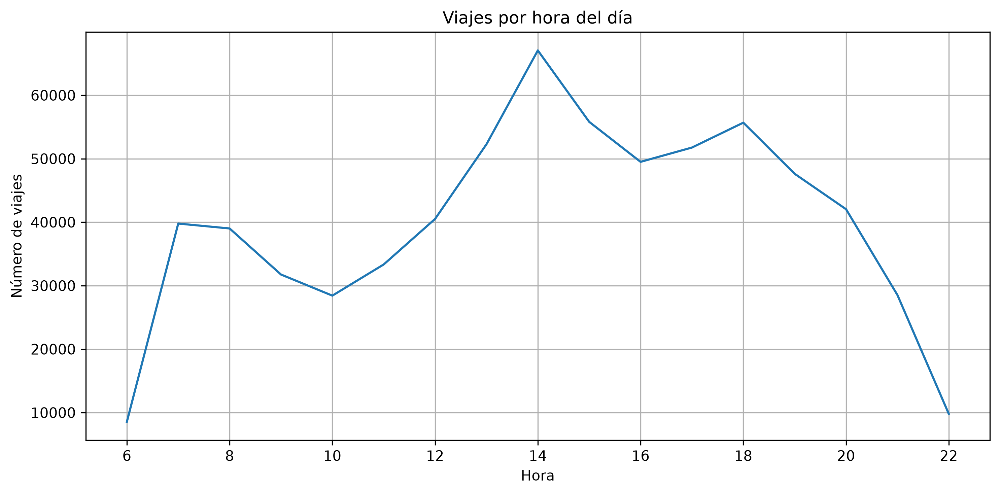

#### Journey Distribution by Day of the Week

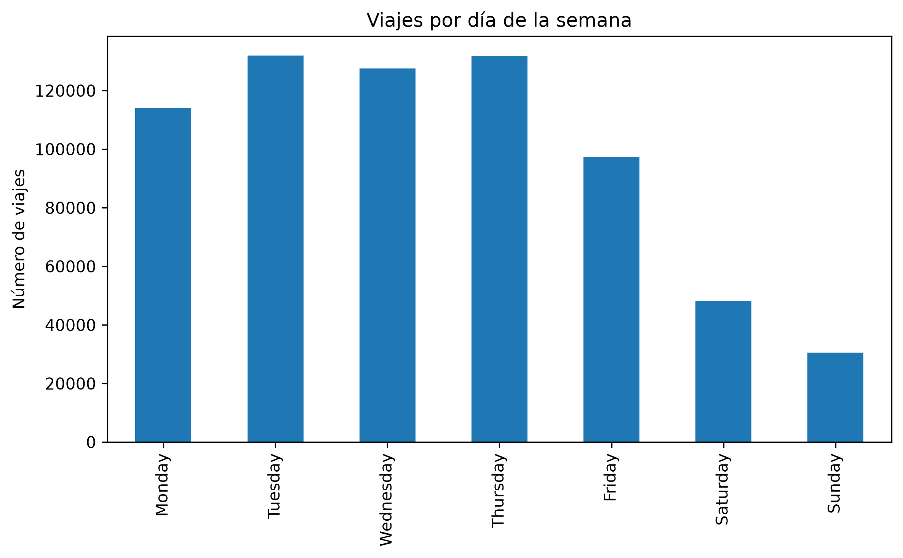

#### Monthly Journey Distribution

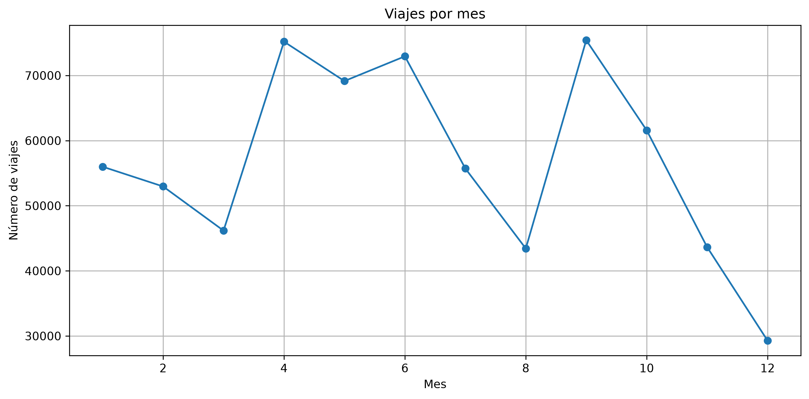

### 2. Relationship Between Weather and Demand

The relationship between demand and different weather variables is analysed, including precipitation, sunshine hours and maximum temperature, as well as differences according to the type of day.

#### Demand According to Precipitation

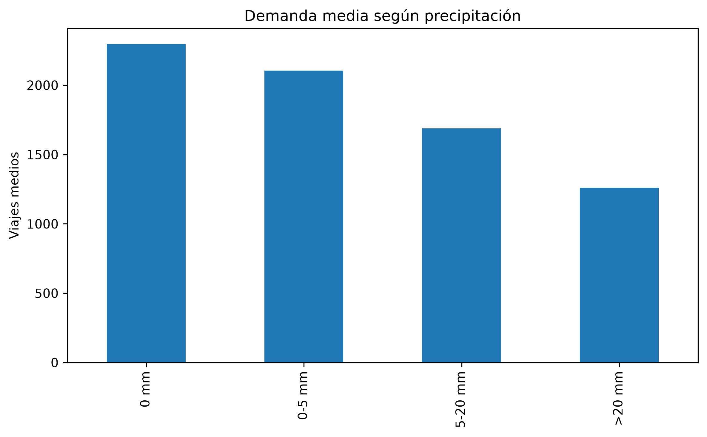

#### Demand According to Sunshine Hours

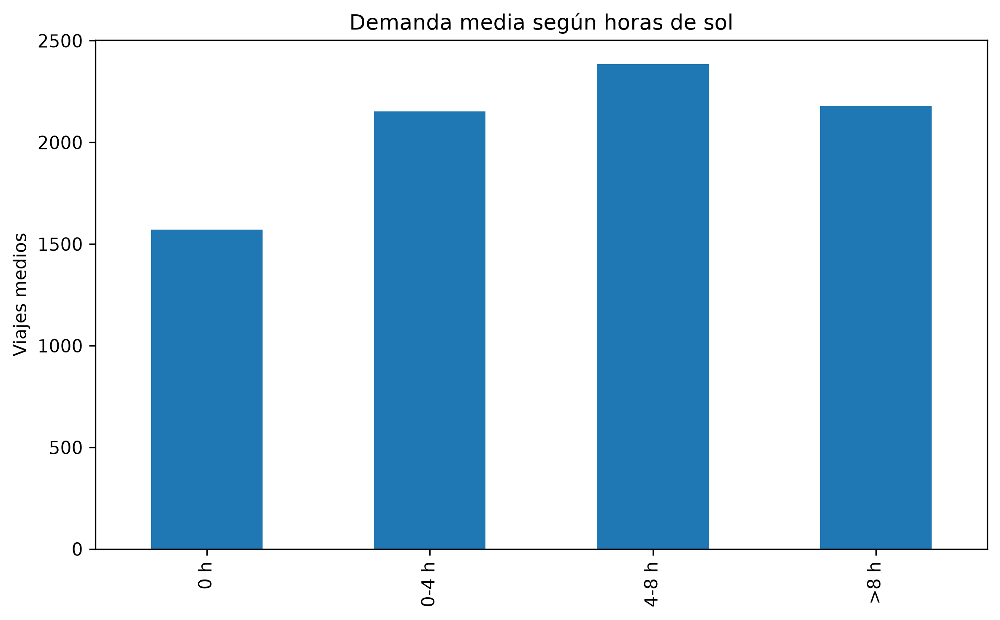

#### Demand According to Maximum Temperature

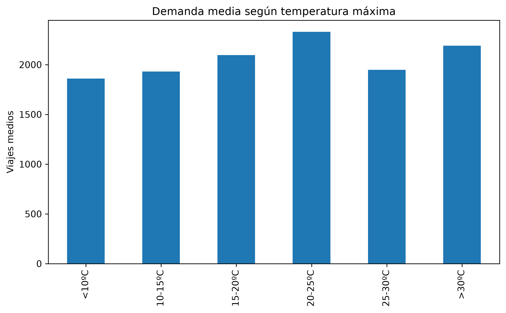

#### Demand According to Day Type

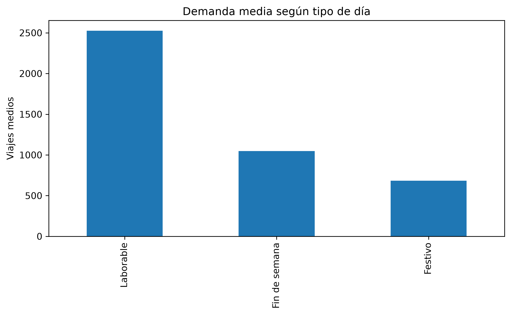

### 3. Station Activity

Station activity levels are compared using the number of departures, arrivals and total movements. The balance between journeys started and completed at each station is also analysed.

#### Stations with the Highest Total Activity

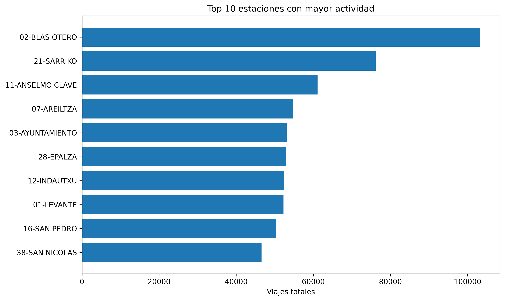

#### Stations with the Highest Number of Departures

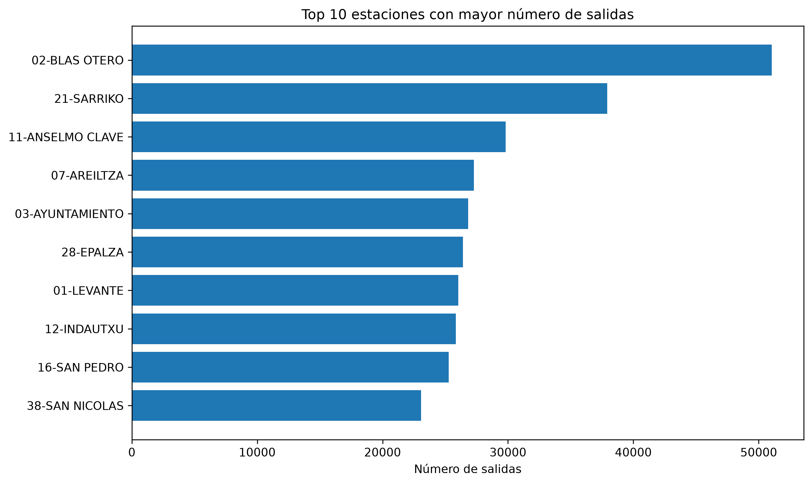

#### Destination Stations

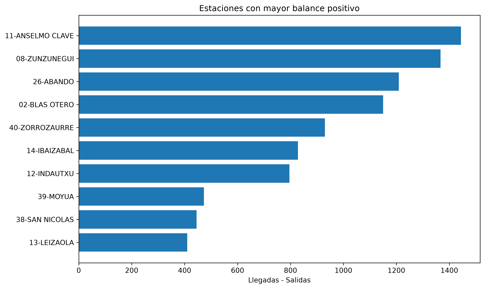

#### Origin Stations

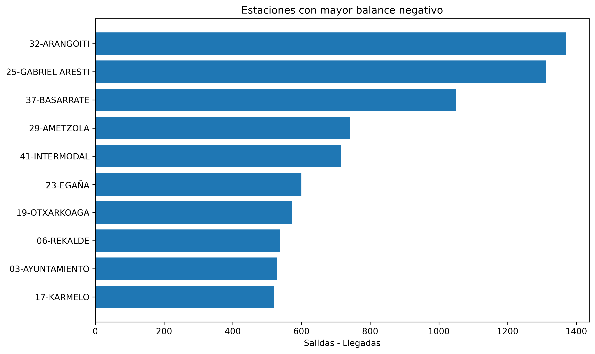

### 4. Spatial Analysis

Geographical representations make it possible to explore the distribution of service activity, identify areas with higher movement concentrations and visualise journey flows between stations.

#### Station Activity Map

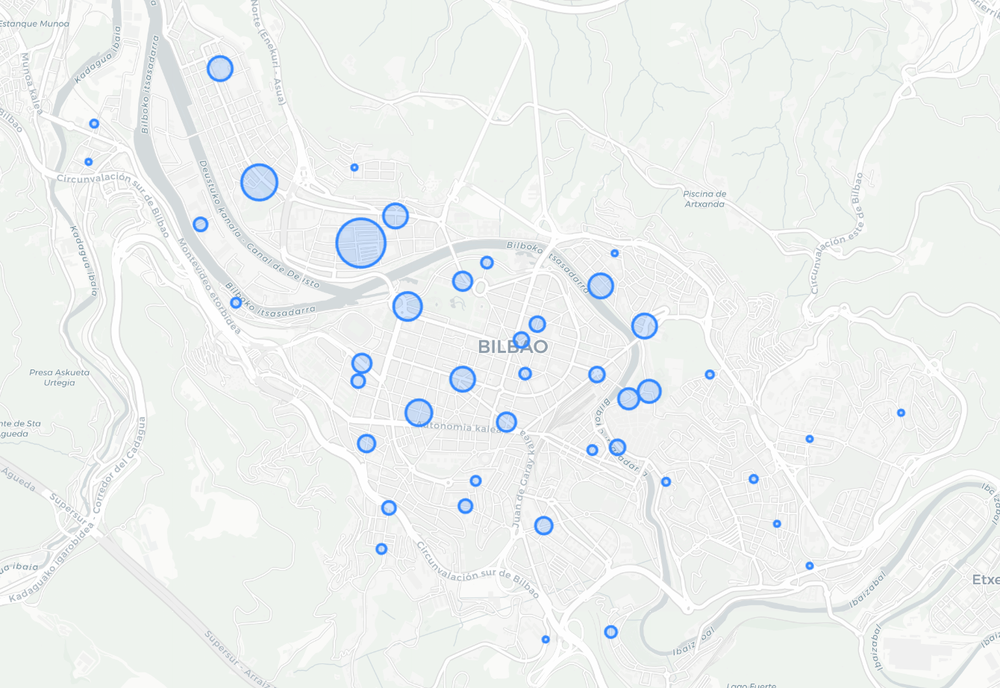

#### Activity Heatmap

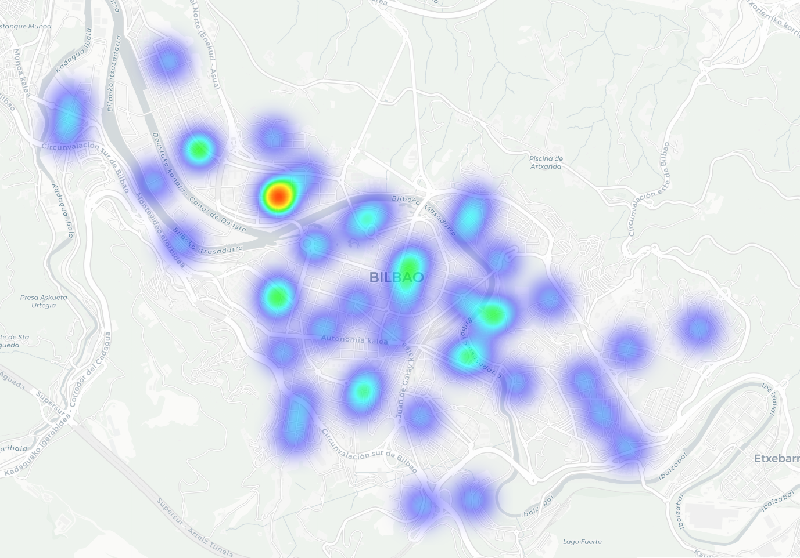

#### Origin-Destination Flow Map

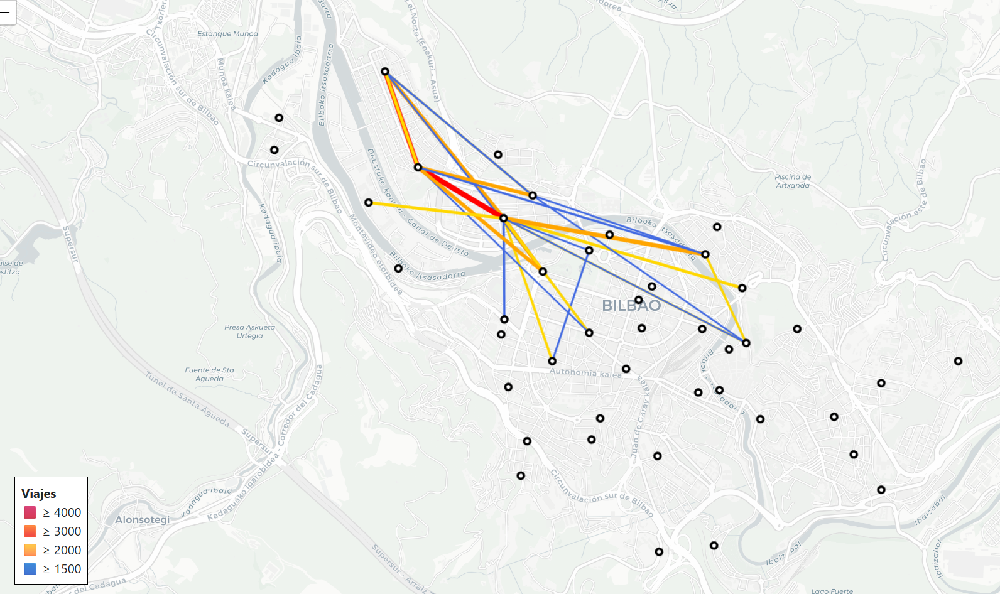

---

## Key Findings

- **Temporal patterns:** activity varies depending on the day of the week. Sundays record fewer journeys, while Tuesdays, Wednesdays and Thursdays stand out among weekdays.

- **Weather and demand:** a negative relationship is observed between precipitation and the number of journeys. The relationship with sunshine hours and maximum temperature follows a less linear pattern.

- **Station activity:** some stations account for a high volume of movements. BLAS OTERO stands out, with more than 100,000 recorded movements. The balance between departures and arrivals makes it possible to identify stations that predominantly generate or receive journeys.

- **Spatial distribution:** the maps make it possible to locate areas with higher activity and explore journey flows between stations.

---

## Technical Challenges

During the development of the project, I had to solve several problems related to data collection, preparation and integration:

- **Data collection:** managing AEMET API request limits, implementing retries and completing downloads. It was also necessary to obtain mobility data through a request to the Transparency Department of Bilbao City Council.

- **Data cleaning and preparation:** standardising formats, converting variables to appropriate data types and preparing mobility and weather data for joint analysis.

- **Data validation:** checking time coverage, identifying missing data and reviewing potential duplicates and inconsistencies before proceeding with the analysis.

- **Geographical representation:** preparing station information and coordinates to represent activity and journeys through interactive maps using Folium. It was also necessary to match historical station identifiers from 2021 with those in the available coordinate file, checking their correspondence to avoid incorrect geographical assignments.

---

## Conclusions

In this project, I analysed Bilbaobizi journeys during 2021 and combined them with AEMET weather data to study the system's usage patterns, station activity and the relationship between demand and weather conditions.

An important part of the work involved preparing and combining both data sources so they could be analysed together. To do this, I used Python and Pandas for data processing, Matplotlib to create visualisations and Folium to represent system activity through interactive maps.

The analysis made it possible to identify temporal patterns and differences in station activity, as well as observe relationships between certain weather variables and demand. However, the results are limited to 2021, and the observed relationships do not, on their own, demonstrate causation.

This project has allowed me to work with real-world data, from preparation to analysis and visualisation, while also addressing challenges related to collecting, cleaning and integrating different data sources.

---

## Future Improvements

The project could be expanded through several improvements to provide a deeper analysis of urban mobility:

- **Extending the study period:** incorporating data from other years to compare demand trends and identify changes in usage patterns.

- **More detailed weather analysis:** studying the relationship between weather conditions and demand in greater depth, taking into account potential differences depending on the time of year and type of day.

- **Improved visualisations:** developing new interactive representations to make it easier to explore temporal patterns, station activity and journey flows.

- **Predictive models:** exploring predictive analysis techniques to forecast future demand based on historical patterns and available weather variables.

---

## Installation and Usage

### 1. Set Up the Environment

Clone the repository and navigate to the project folder:

```bash
git clone https://github.com/fernandezpelayo/bilbao-urban-mobility-analysis.git
cd bilbao-urban-mobility-analysis
```

Create and activate a virtual environment:

```bash
python -m venv .venv
```

**Windows (PowerShell):**

```powershell
.venv\Scripts\Activate.ps1
```

**Linux / macOS:**

```bash
source .venv/bin/activate
```

Install the dependencies:

```bash
pip install -r requirements.txt
```

### 2. Configure API Keys

To download weather data and generate interactive maps, you need your own AEMET and CARTO API keys.

Create a `.env` file in the project root folder, using `.env.example` as a reference:

```env
AEMET_API_KEY=your_aemet_api_key
CARTO_API_KEY=your_carto_api_key
```

### 3. Run the Project

The repository includes the original and processed datasets, so there are two ways to run the project:

- **Use the included data:** run the analysis scripts directly, starting with `05-eda.py` and following the numerical order up to `12-mapa_OD.py`.
- **Run the entire pipeline:** execute the scripts from `01-clima.py` to `12-mapa_OD.py`, following the numerical order.

Downloading weather data requires an AEMET API key. Generating interactive maps requires a CARTO API key.

The results are saved in the corresponding folders within `outputs/`.

### Interactive Maps

The HTML maps are not included in the repository to avoid exposing the CARTO API key they contain.

They can be generated locally by running the scripts `10-mapa_estaciones.py`, `11-heatmap_estaciones.py` and `12-mapa_OD.py`, with the CARTO API key configured in `.env`.

The files are saved in `outputs/estaciones/` and can be opened directly in a web browser. The images included in the repository provide previews of each map.

---

## License

The code in this project is distributed under the MIT License. This license does not extend to the third-party data or resources used in the analysis, which remain subject to their respective terms of use.