# Bilbaobizi 2021: Análisis Exploratorio de la Movilidad Urbana

> Proyecto de análisis exploratorio de datos (EDA) sobre el sistema público de bicicletas de Bilbao mediante la integración de datos de movilidad y meteorología.

---

## Índice

- [Descripción del proyecto](#descripción-del-proyecto)
- [Objetivos](#objetivos)
- [Fuentes de datos](#fuentes-de-datos)
- [Tecnologías utilizadas](#tecnologías-utilizadas)
- [Estructura del proyecto](#estructura-del-proyecto)
- [Pipeline del proyecto](#pipeline-del-proyecto)
- [Limpieza y validación](#limpieza-y-validación)
- [Integración de datos](#integración-de-datos)
- [Análisis realizado](#análisis-realizado)
- [Scripts del proyecto](#scripts-del-proyecto)
- [Resultados](#resultados)
- [Hallazgos principales](#hallazgos-principales)
- [Retos técnicos](#retos-técnicos)
- [Conclusiones](#conclusiones)
- [Líneas futuras](#líneas-futuras)
- [Instalación y uso](#instalación-y-uso)
- [Licencia](#licencia)

---

## Descripción del proyecto

Este proyecto analiza el comportamiento del sistema público de bicicletas **Bilbaobizi** durante el año **2021**, integrando los registros de movilidad con datos meteorológicos obtenidos mediante la **API OpenData de AEMET**.

El objetivo es analizar cómo se relacionan los factores **temporales**, **meteorológicos** y **espaciales**  con la demanda del servicio. 

El proyecto sigue un flujo de trabajo **end-to-end**, desde la obtención y limpieza de los datos hasta la generación de visualizaciones y mapas interactivos.

> **Importante**
>
> Este proyecto **no busca predecir la demanda mediante modelos de Machine Learning**.
>
> Su finalidad es comprender el funcionamiento del sistema mediante técnicas de **Análisis Exploratorio de Datos (EDA)**.

---

## Objetivos

Este proyecto busca responder preguntas como:

- ¿Cuándo se utiliza más Bilbaobizi?
- ¿Qué relación existe entre la meteorología y la demanda?
- ¿Qué estaciones presentan una mayor actividad?
- ¿Existen estaciones claramente emisoras o receptoras?
- ¿Qué rutas concentran el mayor número de desplazamientos?
- ¿Cómo se distribuye espacialmente el uso del sistema dentro de Bilbao?

El propósito del proyecto es obtener información útil para comprender el comportamiento del servicio mediante técnicas de análisis exploratorio de datos.

---

## Fuentes de datos

El proyecto integra dos fuentes de información independientes: los registros de movilidad de Bilbaobizi y los datos meteorológicos de AEMET.

### Datos de movilidad

Los datos históricos de Bilbaobizi se obtuvieron mediante una solicitud realizada al área de Transparencia del Ayuntamiento de Bilbao.

El conjunto de datos contiene información relativa a los desplazamientos realizados en el sistema, incluyendo:

- Estación de origen.
- Estación de destino.
- Fecha y hora de inicio.
- Fecha y hora de finalización.
- Duración del viaje.

La obtención de estos datos constituyó una de las primeras etapas del proyecto y permitió disponer de los registros necesarios para analizar los patrones de movilidad durante 2021.

Los registros de movilidad disponibles para el análisis abarcan desde el 1 de enero hasta el 27 de diciembre de 2021. Por tanto, la cobertura de los datos de movilidad no comprende los últimos cuatro días del año, aunque los datos meteorológicos sí cubren el año completo.

### Datos meteorológicos

Los datos meteorológicos fueron obtenidos mediante la **API OpenData de AEMET**.

Para obtener la información correspondiente a 2021 se desarrolló un proceso automatizado de descarga que tuvo en cuenta las limitaciones de la API y la posibilidad de recibir respuestas incompletas o errores temporales.

Durante este proceso se implementaron:

- reintentos automáticos ante errores de conexión y descarga;
- comprobación de las respuestas HTTP;
- Identificación de los meses cuya descarga no se hubiera completado correctamente;
- pausas entre determinadas peticiones para evitar superar los límites de la API;
- validación final de la cobertura temporal de los datos.

Una vez finalizada la descarga, se validó que los datos meteorológicos cubrieran los **365 días de 2021**, desde el 1 de enero hasta el 31 de diciembre, sin fechas faltantes ni duplicadas.

### Resumen del conjunto de datos

| Característica | Valor |
|----------------|------:|
| Periodo analizado | 2021 |
| Viajes originales | 721.777 |
| Viajes analizados | 681.489 |
| Estaciones | 43 |
| Fuente meteorológica | API OpenData AEMET |

### ¿Por qué 2021?

El análisis se centra en 2021 porque fue el único año de los datos de movilidad proporcionados por el Ayuntamiento que permitió trabajar con una cobertura suficientemente completa y consistente para realizar el análisis de forma fiable.

Además, se pudo disponer de una cobertura meteorológica completa para el mismo periodo, lo que permitió integrar ambas fuentes manteniendo la coherencia temporal durante todo el año.

---

## Tecnologías utilizadas

- Python
- Pandas
- Matplotlib
- python-dotenv
- Folium
- CARTO
- Requests
- API OpenData de AEMET
- Git / GitHub

---

## Estructura del proyecto

El proyecto está organizado en carpetas para separar los datos originales, los datos procesados, los scripts de análisis y las visualizaciones generadas.

```text
bilbao-urban-mobility-analysis/
│
├── data/
│   ├── processed/                    # Datos limpios e integrados
│   └── raw/                          # Datos originales y descargas
│
├── outputs/
│   ├── analisis_estaciones/          # Resultados del análisis de estaciones
│   ├── estaciones/                   # Gráficos y mapas de estaciones
│   ├── factores_demanda/             # Análisis de variables meteorológicas
│   └── patrones_movilidad/           # Análisis temporal de los viajes
│
├── scripts/
│   ├── 01-clima.py                   # Descarga de datos meteorológicos
│   ├── 02-limpieza_movilidad.py      # Limpieza de los datos de movilidad
│   ├── 03-merge.py                   # Integración de movilidad y meteorología
│   ├── 04-depuracion_final.py        # Validación y depuración final
│   ├── 05-eda.py                     # Análisis exploratorio de datos
│   ├── 06-patrones_movilidad.py      # Análisis de patrones temporales
│   ├── 07-analisis_estaciones.py     # Análisis de actividad por estación
│   ├── 08-factores_demanda.py        # Relación entre meteorología y demanda
│   ├── 09-ranking_estaciones.py      # Clasificación de estaciones
│   ├── 10-mapa_estaciones.py         # Mapa de actividad por estación
│   ├── 11-heatmap_estaciones.py      # Mapa de calor de la actividad
│   └── 12-mapa_OD.py                 # Mapa de flujos origen-destino
│
├── .env.example
├── .gitignore
├── LICENSE
├── README_EN.md
├── README_ES.md
└── requirements.txt
```
---

### Variables de entorno

El proyecto utiliza un archivo `.env` para almacenar las claves API necesarias:

- `AEMET_API_KEY`: permite obtener los datos meteorológicos de AEMET.
- `CARTO_API_KEY`: permite generar los mapas interactivos con Folium y CARTO.

El archivo `.env` está excluido del repositorio mediante `.gitignore` para evitar publicar credenciales. Se incluye un archivo `.env.example` como plantilla de configuración.

---

## Pipeline del proyecto

```text
Obtención de datos
                │
                ▼
Limpieza y validación
                │
                ▼
Integración de datasets
                │
                ▼
EDA
                │
                ▼
Análisis temporal
                │
                ▼
Análisis meteorológico
                │
                ▼
Análisis de estaciones
                │
                ▼
Análisis espacial
                │
                ▼
Visualizaciones
                │
                ▼
Hallazgos y conclusiones

```

---

## Limpieza y validación

Antes de comenzar el análisis fue necesario preparar ambos conjuntos de datos.

Entre las principales transformaciones realizadas destacan:

- eliminación de viajes inferiores a 2 minutos;
- eliminación de viajes superiores a 180 minutos;
- conversión de variables numéricas con formato español;
- normalización de fechas;
- creación de variables temporales derivadas como `hora`, `día de la semana` y `fecha` normalizada;
- revisión y tratamiento de valores ausentes;
- validación de la cobertura temporal;
- comprobación de la calidad del proceso de integración.

De los 721.777 registros correspondientes a 2021, se descartaron 39.448 viajes cuya duración no cumplía los criterios establecidos (entre 2 y 180 minutos), quedando 682.329 registros. Posteriormente, tras la integración de los datos, se realizó una depuración adicional para excluir 840 viajes correspondientes a estaciones de servicio interno, como talleres y estaciones de pruebas. El conjunto final utilizado en el análisis quedó formado por **681.489 viajes**.

---

## Integración de datos

Una vez depurados ambos conjuntos de datos, se integraron utilizando la fecha como clave común.

Posteriormente se realizaron distintas comprobaciones sobre el dataset resultante:

- Correspondencia de las fechas de movilidad con los registros meteorológicos disponibles;
- Validación de la relación entre ambos conjuntos de datos para evitar multiplicaciones de registros durante la integración;
- Revisión de valores ausentes en las variables meteorológicas esenciales;
- Comprobación de la estructura y consistencia del dataset resultante.

El resultado es un único dataset preparado para las diferentes fases de análisis.

---

## Análisis realizado

El análisis se estructura en cuatro bloques principales:

### Patrones temporales

Se analiza la distribución de los viajes según:

- hora del día;
- día de la semana;
- mes;
- evolución temporal durante 2021.

---

### Factores meteorológicos

Se estudia la relación entre la demanda y distintas variables meteorológicas, así como las diferencias según el tipo de día:

- Precipitación;
- Horas de sol;
- Temperatura máxima;
- Tipo de día.

**Nota sobre el cálculo de la demanda diaria**

El análisis de los factores que influyen en la demanda utiliza los días con registros de viajes válidos, aplicando previamente los criterios de limpieza establecidos en el proyecto (duración entre 2 y 180 minutos).

Los días sin viajes válidos no se incorporan al cálculo de las medias, ya que no es posible determinar únicamente a partir del registro de viajes si corresponden a días sin actividad del servicio o a periodos sin datos disponibles.

Por este motivo, los resultados representan la demanda media de los días con actividad registrada y no la demanda media de todos los días del año.

---

### Análisis de estaciones

Se calculan indicadores de actividad para cada estación:

- salidas;
- llegadas;
- actividad total;
- balance entre llegadas y salidas.

La actividad total se calcula sumando las salidas y las llegadas registradas en cada estación. Esto permite identificar las estaciones con mayor volumen de movimientos y diferenciar aquellas con un balance predominantemente emisor o receptor.

---

### Análisis espacial

Se representa espacialmente la actividad del sistema mediante:

- mapa de actividad por estaciones;
- HeatMap;
- mapa de flujos Origen-Destino.

---

## Scripts del proyecto

| Script | Descripción |
|---------|-------------|
| 01-clima.py | Descarga de datos meteorológicos desde la API de AEMET. |
| 02-limpieza_movilidad.py | Limpieza y preparación de los datos de movilidad. |
| 03-merge.py | Integración entre movilidad y meteorología. |
| 04-depuracion_final.py | Validación y depuración del dataset final. |
| 05-eda.py | Exploración inicial del conjunto de datos. |
| 06-patrones_movilidad.py | Análisis temporal de la demanda. |
| 07-analisis_estaciones.py | Cálculo y análisis de indicadores generales por estación. |
| 08-factores_demanda.py | Relación entre meteorología y demanda. |
| 09-ranking_estaciones.py | Ranking de estaciones y generación de gráficos. |
| 10-mapa_estaciones.py | Mapa interactivo de actividad por estación. |
| 11-heatmap_estaciones.py | HeatMap de la actividad del sistema. |
| 12-mapa_OD.py | Mapa interactivo de flujos Origen-Destino. |

---

## Resultados

### 1. Patrones temporales de movilidad

El análisis temporal permite identificar variaciones en la demanda según la hora del día, el día de la semana y el mes, mostrando los principales patrones de uso del servicio.

#### Distribución de los viajes por hora

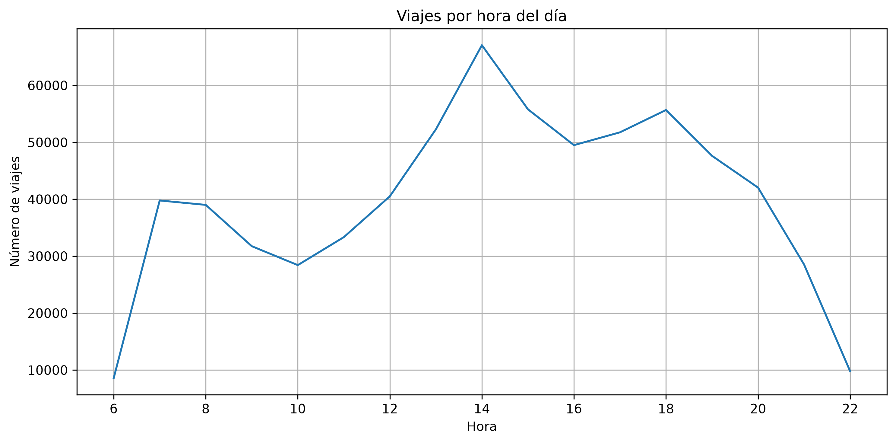

#### Distribución de los viajes por día de la semana

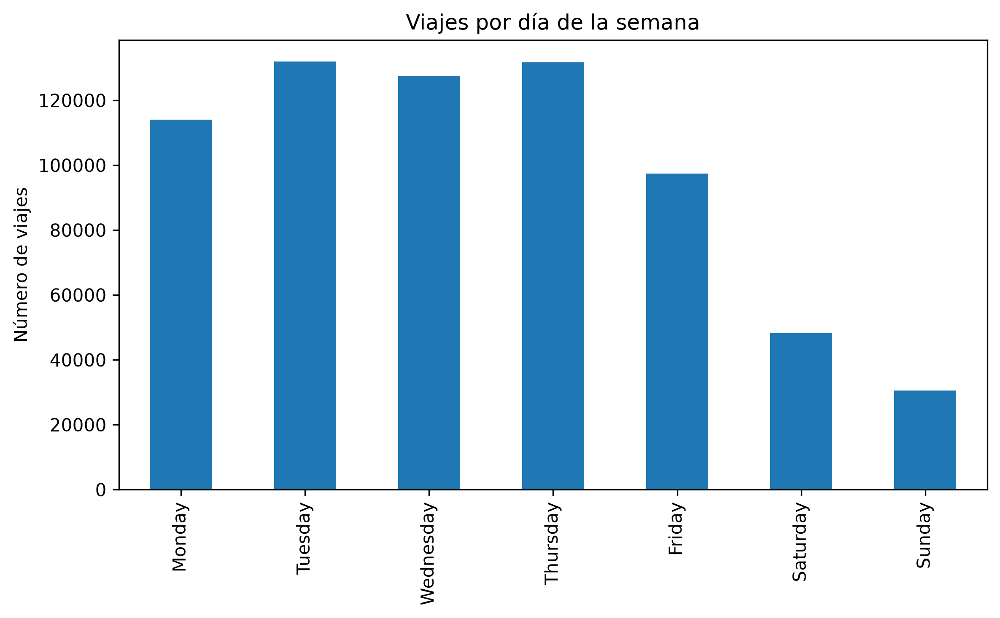

#### Distribución mensual de los viajes

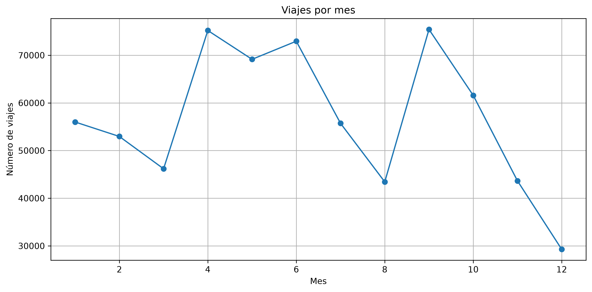


### 2. Relación entre meteorología y demanda

Se analiza la relación entre la demanda y distintas variables meteorológicas, como la precipitación, las horas de sol y la temperatura máxima, así como las diferencias según el tipo de día.

#### Demanda según la precipitación

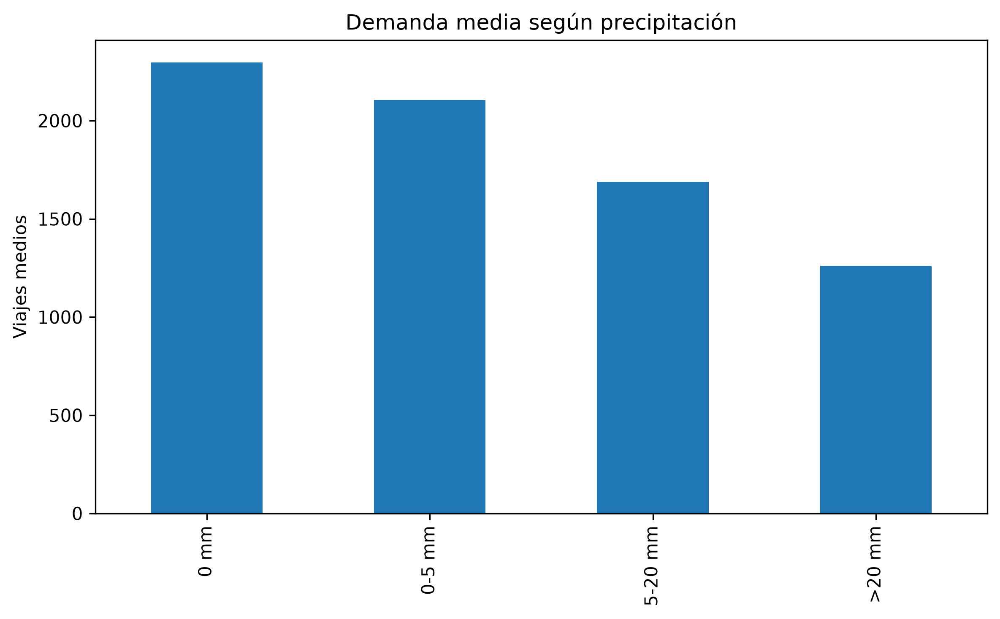

#### Demanda según las horas de sol

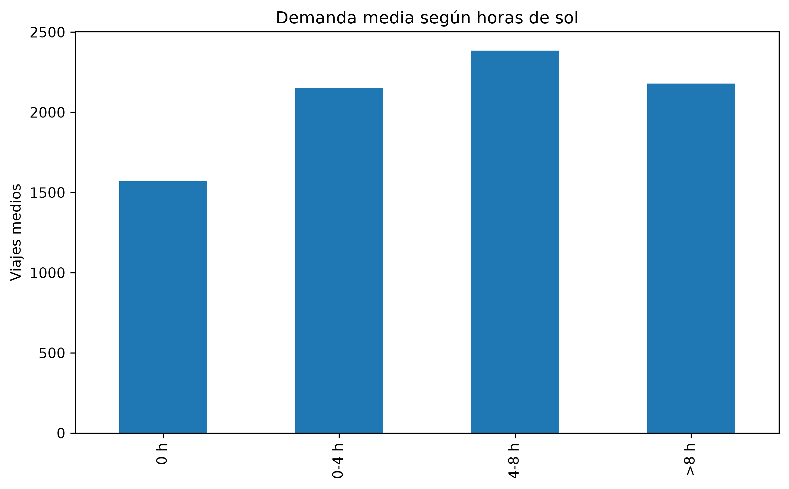

#### Demanda según la temperatura máxima

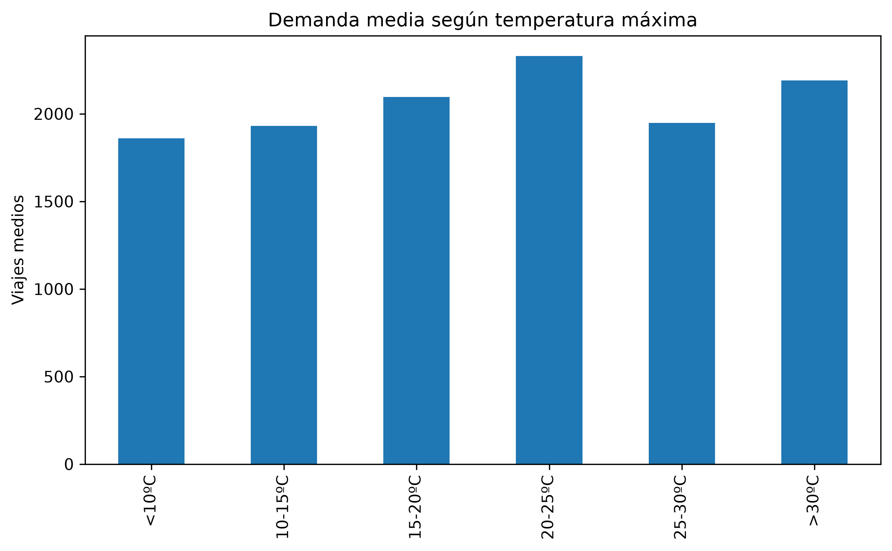

#### Demanda según el tipo de día

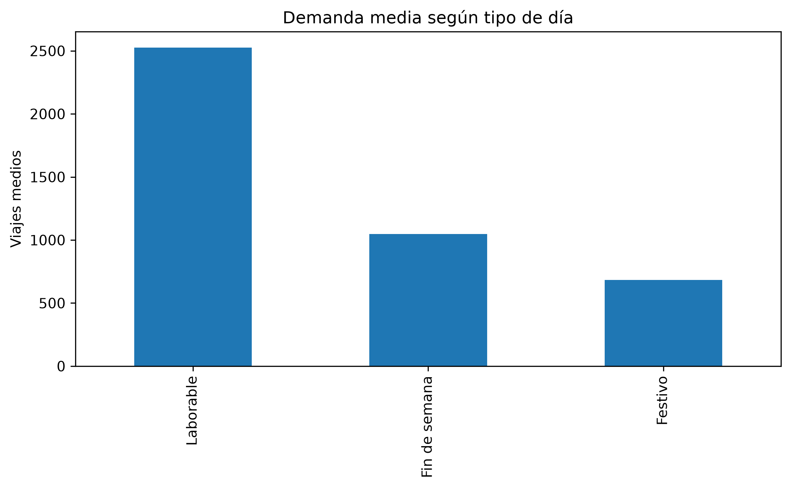


### 3. Actividad de las estaciones

Se comparan los niveles de actividad de las estaciones mediante el número de salidas, llegadas y movimientos totales, además de analizar el balance entre viajes iniciados y finalizados en cada estación.

#### Estaciones con mayor actividad total

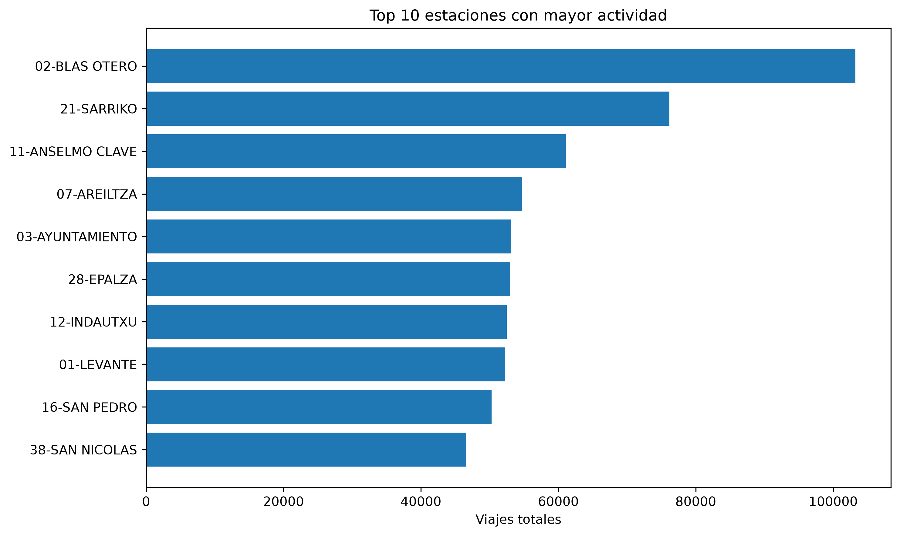

#### Estaciones con mayor número de salidas

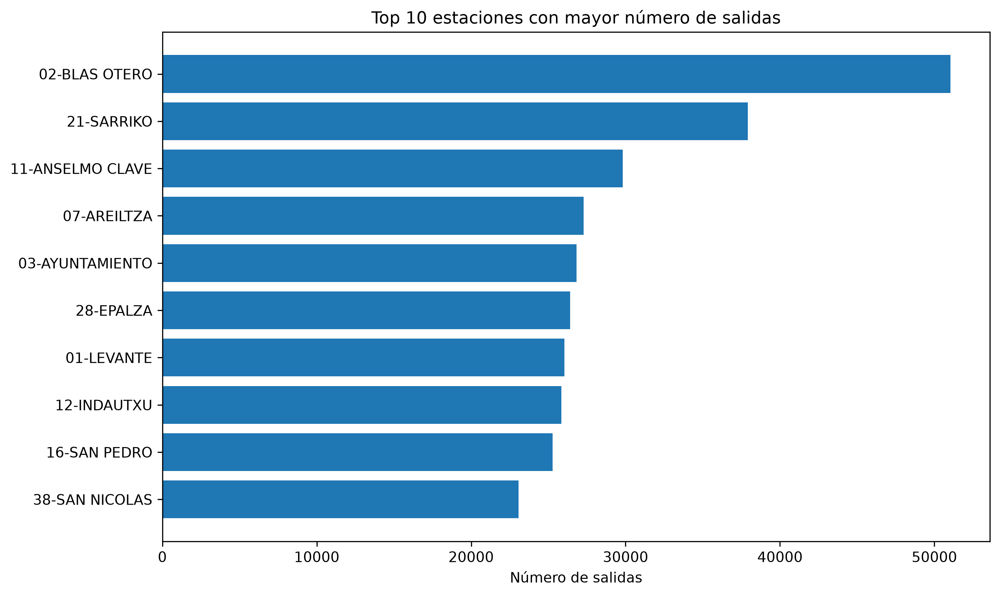

#### Estaciones receptoras

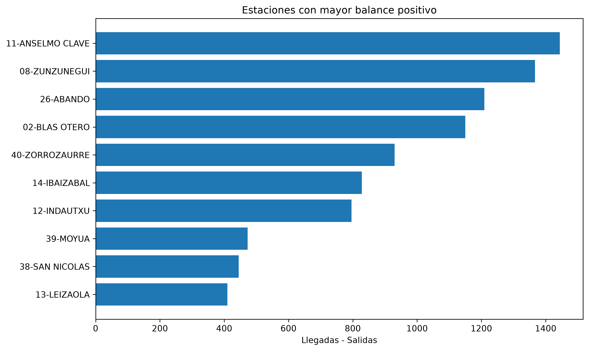

#### Estaciones emisoras

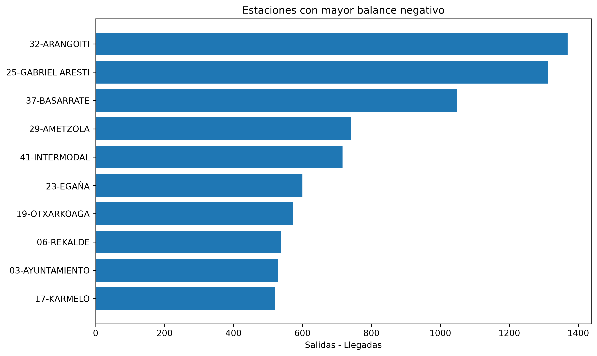


### 4. Análisis espacial

La representación geográfica permite explorar la distribución de la actividad del servicio, identificar zonas con mayor concentración de movimientos y visualizar los flujos de viajes entre estaciones.

#### Mapa de actividad por estación

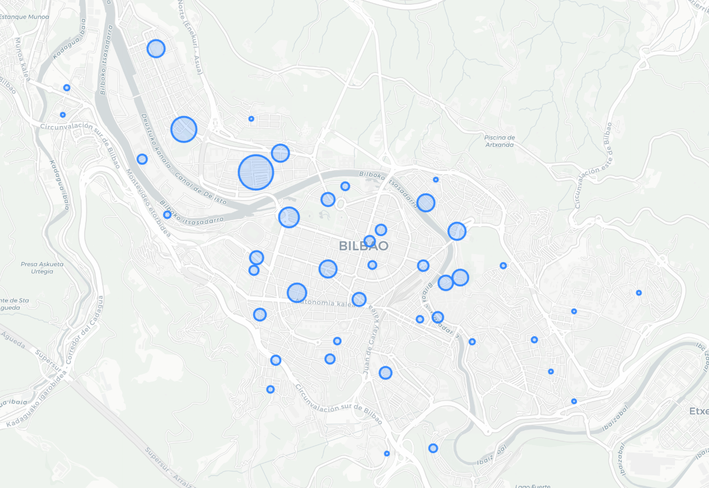

#### Mapa de calor de la actividad

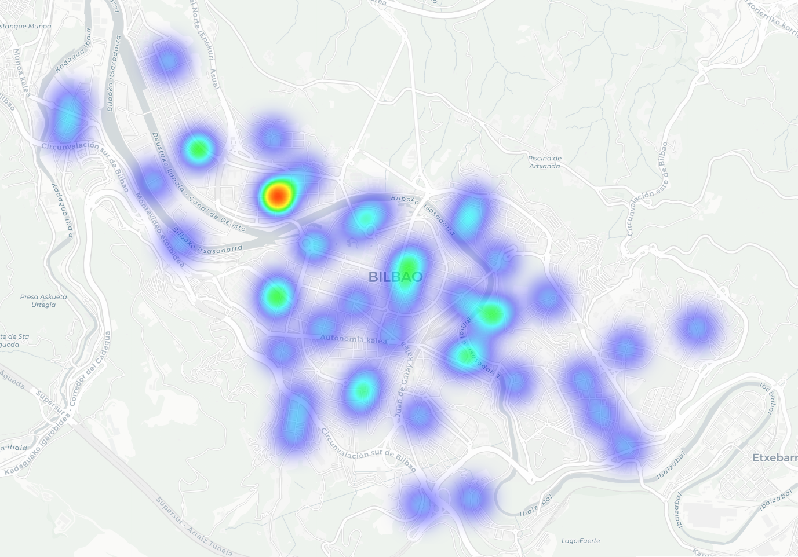

#### Mapa de flujos Origen-Destino

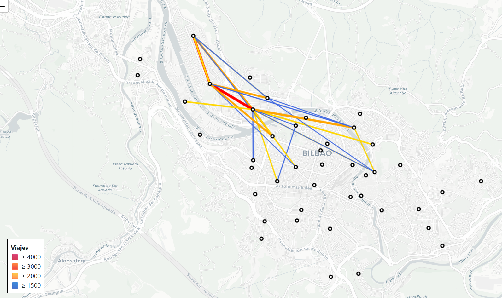

---

## Hallazgos principales

- **Patrones temporales:** la actividad varía según el día de la semana. Los domingos registran menos desplazamientos, mientras que los martes, miércoles y jueves destacan entre los días laborables.

- **Meteorología y demanda:** se observa una relación negativa entre la precipitación y el número de desplazamientos. La relación con las horas de sol y la temperatura máxima presenta un patrón menos lineal.

- **Actividad de las estaciones:** algunas estaciones concentran un volumen elevado de movimientos. Destaca BLAS OTERO, con más de 100.000 movimientos registrados. El balance entre salidas y llegadas permite distinguir estaciones principalmente emisoras y receptoras.

- **Distribución espacial:** los mapas permiten localizar las zonas con mayor actividad y explorar los flujos de desplazamientos entre estaciones.

---

## Retos técnicos

Durante el desarrollo del proyecto tuve que resolver varios problemas relacionados con la obtención, la preparación y la integración de los datos:

- **Obtención de datos:** gestionar los límites de peticiones de la API de AEMET, implementar reintentos y completar las descargas. También fue necesario obtener los datos de movilidad mediante una solicitud al área de Transparencia del Ayuntamiento de Bilbao.

- **Limpieza y preparación:** normalizar formatos, convertir variables a tipos adecuados y preparar los datos de movilidad y meteorología para su análisis conjunto.

- **Validación de los datos:** comprobar la cobertura temporal, identificar datos ausentes y revisar posibles duplicados e inconsistencias antes de continuar con el análisis.

- **Representación geográfica:** preparar la información de las estaciones y sus coordenadas para representar la actividad y los desplazamientos mediante mapas interactivos con Folium. También fue necesario relacionar los identificadores históricos de las estaciones de 2021 con los identificadores del archivo de coordenadas disponible, comprobando su correspondencia para evitar asignaciones geográficas incorrectas.

---

## Conclusiones

En este proyecto he analizado los desplazamientos de Bilbaobizi durante 2021 y los he combinado con datos meteorológicos de AEMET para estudiar los patrones de uso del servicio, la actividad de las estaciones y la relación entre la demanda y las condiciones meteorológicas.

Una parte importante del trabajo ha sido preparar y combinar ambas fuentes de datos para poder analizarlas conjuntamente. Para ello he utilizado Python y Pandas en el procesamiento de los datos, Matplotlib para crear visualizaciones y Folium para representar la actividad del servicio mediante mapas interactivos.

El análisis ha permitido identificar patrones temporales y diferencias de actividad entre estaciones, además de observar relaciones entre algunas variables meteorológicas y la demanda. No obstante, los resultados se limitan a 2021 y las relaciones observadas no demuestran por sí solas una relación de causalidad.

Este proyecto me ha permitido trabajar con datos reales desde su preparación hasta su análisis y visualización, abordando también dificultades relacionadas con la obtención, la limpieza y la integración de distintas fuentes de información.

---

## Líneas futuras

El proyecto puede ampliarse mediante diferentes mejoras que permitan profundizar en el análisis de la movilidad urbana:

- **Ampliación del periodo de estudio:** incorporar datos de otros años para comparar la evolución de la demanda e identificar cambios en los patrones de uso del servicio.

- **Análisis meteorológico más detallado:** estudiar con mayor profundidad la relación entre las condiciones meteorológicas y la demanda, teniendo en cuenta posibles diferencias según la época del año y el tipo de día.

- **Mejora de las visualizaciones:** desarrollar nuevas representaciones interactivas que faciliten la exploración de los patrones temporales, la actividad de las estaciones y los flujos de viajes.

- **Modelos predictivos:** explorar técnicas de análisis predictivo para predecir la demanda futura a partir de los patrones históricos y las variables meteorológicas disponibles.

---

## Instalación y uso

### 1. Preparar el entorno

Clonar el repositorio y acceder a la carpeta del proyecto:

```bash
git clone https://github.com/fernandezpelayo/bilbao-urban-mobility-analysis.git
cd bilbao-urban-mobility-analysis
```

Crear y activar un entorno virtual:

```bash
python -m venv .venv
```

**Windows (PowerShell):**

```powershell
.venv\Scripts\Activate.ps1
```

**Linux / macOS:**

```bash
source .venv/bin/activate
```

Instalar las dependencias:

```bash
pip install -r requirements.txt
```

### 2. Configurar las claves API

Para descargar los datos meteorológicos y generar los mapas interactivos es necesario disponer de claves propias de AEMET y CARTO.

Crear un archivo `.env` en la carpeta principal, tomando como referencia `.env.example`:

```env
AEMET_API_KEY=tu_clave_de_aemet
CARTO_API_KEY=tu_clave_de_carto
```

### 3. Ejecutar el proyecto

El repositorio incluye los datos originales y procesados, por lo que existen dos formas de ejecutar el proyecto:

- **Utilizar los datos incluidos:** ejecutar directamente los scripts de análisis, comenzando por `05-eda.py` y siguiendo el orden numérico hasta `12-mapa_OD.py`.
- **Repetir el proceso completo:** ejecutar los scripts del `01-clima.py` al `12-mapa_OD.py`, siguiendo el orden numérico.

La descarga meteorológica requiere una clave API de AEMET. La generación de mapas interactivos requiere una clave de CARTO.

Los resultados se guardan en las carpetas correspondientes dentro de `outputs/`.

#### Mapas interactivos

Los mapas HTML no se incluyen en el repositorio para evitar exponer la clave API de CARTO que contienen.

Pueden generarse localmente ejecutando los scripts `10-mapa_estaciones.py`, `11-heatmap_estaciones.py` y `12-mapa_OD.py`, con la clave de CARTO configurada en `.env`.

Los archivos se guardan en `outputs/estaciones/` y pueden abrirse directamente en un navegador. Las imágenes incluidas en el repositorio muestran una vista previa de cada mapa.

---

## Licencia

El código de este proyecto se distribuye bajo la licencia MIT. Esta licencia no se extiende a los datos ni a los recursos de terceros utilizados en el análisis, que mantienen sus respectivas condiciones de uso.
